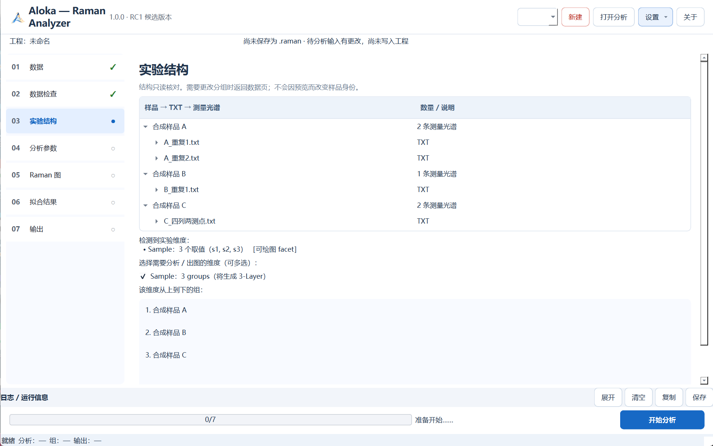
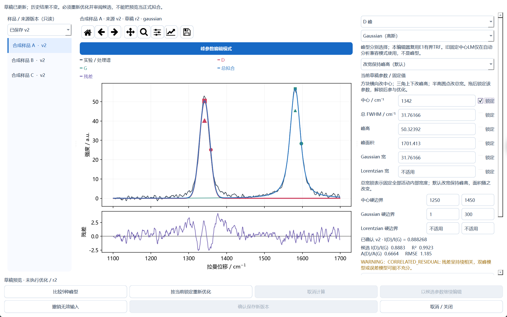
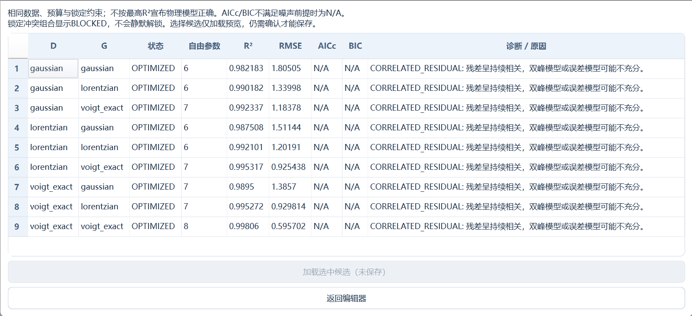

  

<h1 align="center">Aloka — Raman Analyzer</h1>

<strong>Sun’s Workshop</strong> · Windows x64

碳材料拉曼光谱的 D/G 分峰工作台 A D/G peak analysis workbench for carbon-material Raman spectra

> **Aloka 1.0 is being prepared for public release. Downloads are not available yet.**
>
> **Aloka 1.0 正在准备公开发布，目前尚未开放下载。**

[Introduction](#introduction--简介) · [Features](#features--主要功能) · [Screenshots / 界面](#screenshots) · [The Story Behind Aloka](#the-story-behind-aloka) · [GitHub Issues](https://github.com/docsun2007/Aloka/issues)

## Introduction / 简介

Aloka 是一款面向碳材料拉曼光谱的 Windows 桌面应用。它把 TXT 导入、样品与重复测量组织、数据检查、预处理、D/G 双峰拟合和结果导出放在同一个工作台中。界面支持简体中文和英文。

- **拟合与诊断。** D 峰和 G 峰可分别采用 Gaussian、Lorentzian 或精确 Voigt。对照九种组合、残差和诊断，再结合实验背景判断拟合是否适用。
- **交互调整。** 预览峰中心、峰高和峰宽的修改，锁定指定参数并重新优化。候选结果经确认后保存为新版本。
- **工程与结果。** 将数据和已确认结果保存到可重开的 `.raman` 工程。峰高比 I(D)/I(G) 与峰面积比分开报告。
- **导出。** 生成 Excel 工作簿（`.xlsx`）。使用单独安装并配置的 Origin，还可将选定的样品与已确认结果导出为 Origin 工程（`.opju`）。

## Features / 主要功能

Aloka is a Windows desktop application for Raman analysis of carbon materials. It brings TXT import, sample and replicate organization, input checks, preprocessing, D/G peak fitting, and export into one workbench. The interface is available in Simplified Chinese and English.

- **Fitting and diagnostics.** Choose Gaussian, Lorentzian, or exact Voigt independently for each peak. Compare nine combinations, review residuals and diagnostics, and judge the fit in its experimental context.
- **Interactive editing.** Preview changes to peak centers, heights, and widths, lock selected parameters, and refit. Confirm a candidate to save it as a new version.
- **Projects and results.** Save data and confirmed results in a reopenable `.raman` project. The I(D)/I(G) peak-height ratio and peak-area ratio are reported separately.
- **Export.** Create Excel workbooks (`.xlsx`). With a separately installed and configured copy of Origin, export selected samples and confirmed results to an Origin project (`.opju`).

## Screenshots

真实 Windows 候选版界面，使用合成演示光谱。  
Actual Windows release-candidate screens with synthetic demo spectra.

**样品与重复测量 / Samples and repeat measurements**

**专业分峰编辑与残差 / Peak editor and residuals**

**九种峰型组合对照 / Nine model combinations**

## Tested environment / 已验证环境

| Scope / 范围 | Verified locally / 已在本机验证 |
| --- | --- |
| Windows | Windows 11 x64。已完成安装、分析、编辑、保存和工程重开。 / Installation, analysis, editing, saving, and reopening on Windows 11 x64. |
| Excel export | 已验证实际生成 XLSX。导出无需安装 Microsoft Excel。 / Verified XLSX export. Microsoft Excel is optional. |
| Origin export | OriginPro 2026。已生成并独立重开 OPJU。 / OPJU export and independent reopening verified on OriginPro 2026. |

Windows 10、Windows ARM64、macOS、Linux 和其他 Origin 版本尚未在本次验收中确认。Origin 自动化还取决于本机安装与 COM 配置。  
Windows 10, Windows on ARM, macOS, Linux, and other Origin versions are outside the verified scope. Origin automation also depends on the local installation and COM configuration.

[环境与使用说明 / Setup and usage notes](INSTALLATION.md) · [第三方组件说明 / Third-party notices](THIRD_PARTY_NOTICES.md)

## Download / 下载

Aloka 1.0 is being prepared for public release. Downloads are not available yet.  
Aloka 1.0 正在准备公开发布，目前尚未开放下载。

## Tutorial / 教程

中文快速入门视频正在完成发布审查。可先阅读[快速使用指南](USER_GUIDE.md)。  
The Mandarin quick-start video is under release review. See the [quick-start guide](USER_GUIDE.md).

## Validation / 科学与功能验证

[验证方法、结论与范围 / Methods, results and scope](docs/VALIDATION.md)

## Development History / 研发历史

[研发历史 / Development history](docs/DEVELOPMENT_HISTORY.md) · [变更记录 / Changelog](CHANGELOG.md)

## Known Issues / 已知问题

[外部兼容与使用限制 / External compatibility and limitations](KNOWN_ISSUES.md)

## The Story Behind Aloka

Aloka 从一个具体的分析问题出发：同一样品往往有多次测量，而从谱图整理、试拟合到图表导出，每一步都需要知道用的是哪份数据、哪组参数和哪一版结果。Aloka 将这些步骤放进一个可重开的工程，让使用者能回看参数、残差和诊断，再决定如何解释拟合结果。

Aloka grew out of a practical analysis problem: samples often have repeat measurements, and it can be difficult to keep track of which data, parameters, and fit version produced a figure. Aloka keeps those steps in a reopenable project so users can revisit the parameters, residuals, and diagnostics before interpreting the result.

## Sun’s Workshop

Sun’s Workshop 是 Aloka 的开发与展示品牌。这个项目聚焦一条具体的科研操作链，从组织测量到保存可复查、可继续编辑的结果。

Sun’s Workshop is the studio name behind Aloka. The project focuses on a practical research workflow, from organizing measurements to saving results that can be revisited and edited.

## Feedback / 反馈

这里是产品展示页。Aloka 应用源码保留私有。安装包正在进行发行审核，教程暂未开放。  
This repository showcases Aloka. The application source remains private. The installer is under release review, and the tutorial is not yet available.

欢迎在 [GitHub Issues](https://github.com/docsun2007/Aloka/issues) 提出功能建议或可复现问题。请提供软件版本、Windows 版本、复现步骤和错误码，并先移除本机路径、个人信息和未公开的科研数据。  
Use [GitHub Issues](https://github.com/docsun2007/Aloka/issues) for suggestions or reproducible problems. Include the build, Windows version, steps, and error code. Remove local paths, personal details, and unpublished research data before posting.